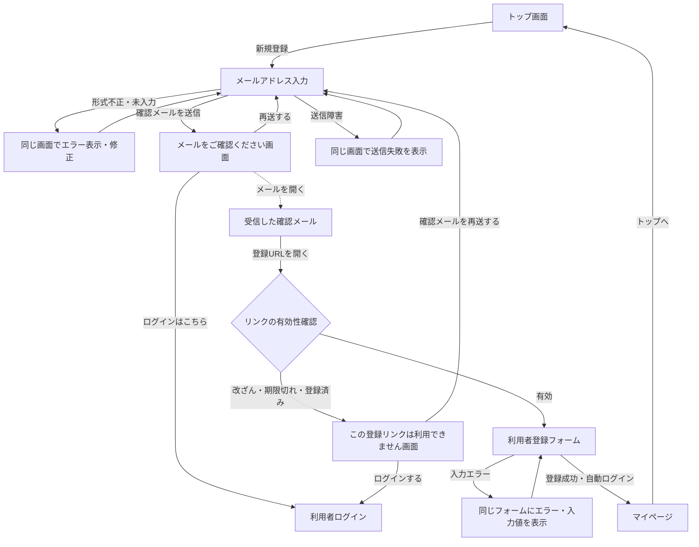
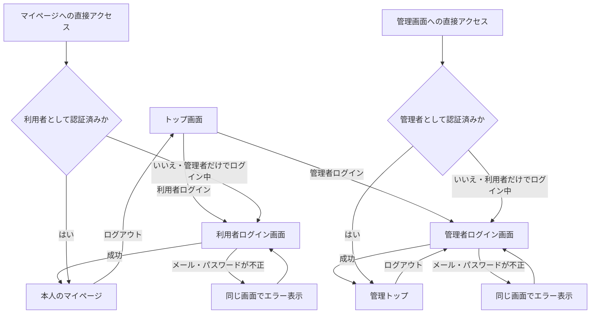

# 02 認証・権限：画面遷移案

- Status: レビュー待ち（未承認・未実装）
- Revision: 1
- Date: 2026-11-19
- Linear: LET-15 / LET-26 / LET-28
- 対象: F-001〜003、D-002〜003、Q-004の認証部分。F-017の他利用者の注文へのアクセス拒否は注文実装時に別途レビュー・検証する。

## 利用者の新規登録

### 画面と振る舞いの提案

| 画面 | 入力・表示 | 主な操作 |
|---|---|---|
| トップ | サービス説明、新規登録、利用者ログイン。ログイン中はマイページとログアウト | 登録／ログイン／マイページ |
| メールアドレス入力 | メールアドレスのみ | 確認メールを送信／ログインへ戻る |
| メール確認案内 | 受信箱・迷惑メールフォルダの確認、再送案内 | メール入力へ戻る／ログイン |
| 確認メール | サービス名、有効期限、登録URL、心当たりがない場合は無視できる旨 | 登録フォームを開く |
| 利用者登録フォーム | 確認済みメール（変更不可）、氏名、電話番号、パスワード、パスワード確認 | 登録する／メール入力からやり直す |
| 無効リンク | 無効・期限切れ・登録済みをまとめた案内 | メール入力へ戻る／ログイン |
| マイページ | ログイン中の利用者自身の氏名・メール・電話番号。注文機能の導線は後続スライスで追加 | トップへ／ログアウト |

- 登録URLは30分有効とする案。開いただけでは消費せず、登録が成功したら再利用できなくする。入力エラーなら同じリンクで修正できる。
- メールから来たURLなしの直接アクセス、トークンの改ざん、メールの差し替えでは登録できない。
- メール再送は60秒間隔とする案。短時間の連続送信では待ち時間を表示し、同じ画面に留まる。
- 登録済みメールでも送信後の案内を変えず、画面だけではアカウントの有無を判別させない。案内にはログイン導線を常に表示する。
- メール入力時点では利用者アカウントを作成しない。氏名などを入力して正常登録した時点で作成する。

## ログイン・ログアウトとアクセス境界

- 利用者・管理者のログイン画面はメールアドレスとパスワードを入力する。
- 管理者登録画面・公開の管理者作成APIは作らず、管理者はseedで用意する。管理者登録URLへのアクセスは404。
- マイページはURLの利用者IDを受け付けず、セッションの本人だけを表示する。注文などの所有者確認は、そのリソースの画面遷移レビューと実装で追加する。
- 管理トップは、この段階では管理者としてログインできていることと管理者名を表示する。献立等の管理導線は各後続スライスで追加する。
- PCとモバイルは同じ遷移・入力項目とし、フォーム・エラー・ログアウトまで両方で検証する。
- パスワード再設定、メールアドレス変更、退会はこのマイルストーンに含めない。

## 承認記録

未承認。実装開始前に、このrevisionに対するユーザーの承認をここへ記録し、各Linearチケットへ同期する。変更が必要ならrevisionを更新して再レビューする。
